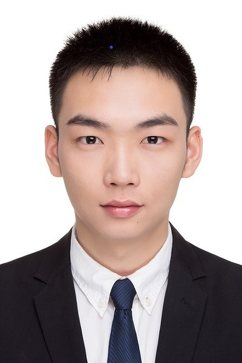
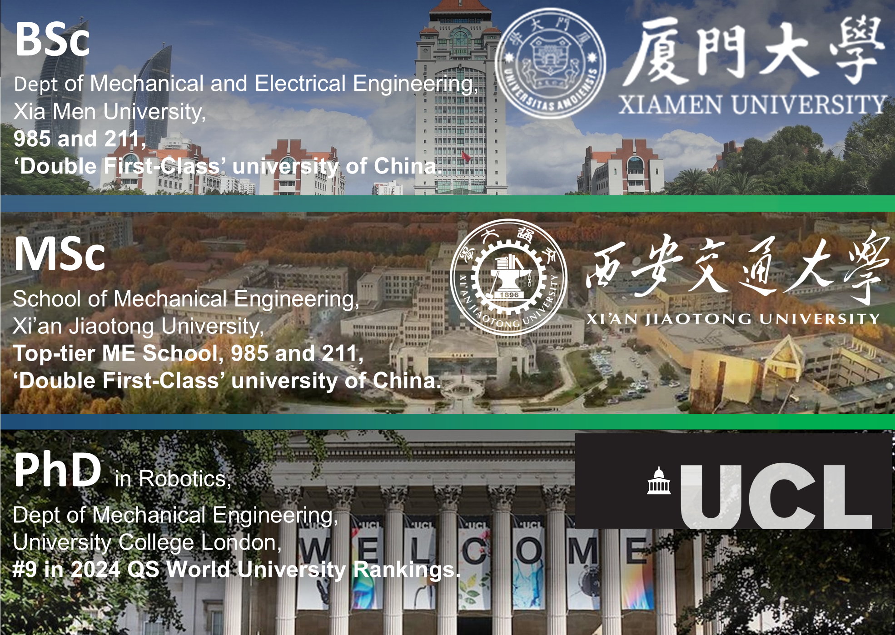
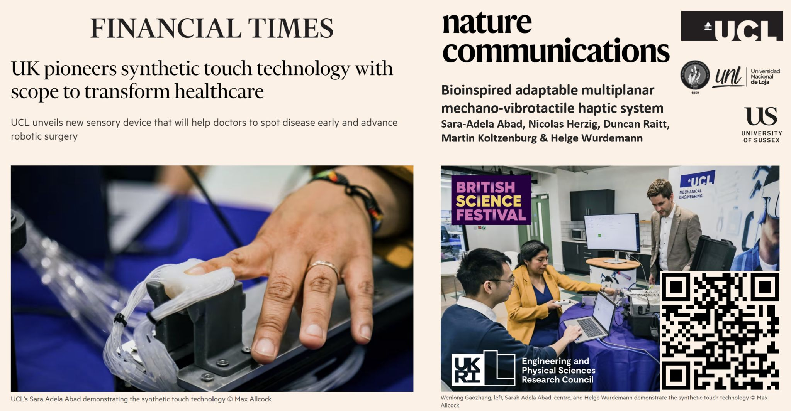

<!--# Dr. Wenlong Gaozhang-->
**Lecturer in Robotics and AI,  
School of Computer Science and Electronic Engineering  
University of Essex  
Colchester, UK**  

---

    
     

        I am a <strong>lecturer at the University of Essex</strong> and former UCL Research Fellow, working at the intersection of advanced mechatronics, multi-physics high-fidelity modelling, and next-generation AI. Over the past six years, my research has spanned the full <strong>physical-to-virtual pipeline</strong>: designing, fabricating, and control-programming modular hybrid variable-stiffness manipulators and electronics-free bionic sensors, and running non-linear elastomeric simulations in multiphysics environments. My published and under-review work includes papers in <strong>Advanced Science, IJRR, and IEEE Transactions on Robotics</strong>, spanning biomimetic systems, fluidic/pneumatic actuation, and rigid-soft hybrid robot architectures. I am currently extending this work toward <strong>AI-guided embodiment and physics-aware world models</strong>, integrating learning-based control with compliant robotic architectures. Using <strong>NVIDIA Isaac Sim</strong>, I build GPU-accelerated parallel environments, high-throughput synthetic data pipelines, and train <strong>reinforcement learning (RL) policies</strong> for end-to-end control. My long-term goal is a robust combination of classical physical modelling and generative AI, with deterministic safety envelopes constraining exploratory neural control.
    

<!-- 解决问题的关键：清除浮动 -->

---

## 🎓 Education
- **PhD in Robotics**, University College London (UCL), UK --- Oct 2020 to Mar 2025
- **MSc in Mechanical Engineering (Distinction)**, Xi'an Jiaotong University, China --- Sep 2017 to Jul 2020
- **BEng in Mechanical Engineering (Distinction)**, Xiamen University, China --- Sep 2013 to Jul 2017

## 🔬 Research Interests
- **Modular Hybrid Variable Stiffness Robotic Manipulator** --- Collaboration with Professor Helge Arne Wurdemann

---

    <video width="100%" controls>
        <source src="assets/videos/modular-stiffness-cobot-supplementary.mp4" type="video/mp4">
        Your browser does not support the video tag.
    </video>

---

- **Bio-Inspired Fluidic Sensing for Proprioceptive Underwater Manipulators** --- Collaboration with Professor Yuanchang Liu and Professor Helge Arne Wurdemann

---

    <video width="100%" controls>
        <source src="assets/videos/underwater-situational-awareness-supplementary.mp4" type="video/mp4">
        Your browser does not support the video tag.
    </video>

---

- **Soft Continuum Manipulator with Reinforced Chambers** --- Co-project with Dr. Jialei Shi.

---

    <video width="100%" controls>
        <source src="assets/videos/soft-continuum-manipulator-demo.mp4" type="video/mp4">
        Your browser does not support the video tag.
    </video>

---

- **Soft Tactile Sensors** --- Co-project with Dr. Yue Li.

---

    <video width="100%" controls>
        <source src="assets/videos/soft-tactile-sensor-demo.mp4" type="video/mp4">
        Your browser does not support the video tag.
    </video>

---

- **Soft Haptic Feedback System** --- Project Research Assistant - Dr. Sara Adela Abad G. 🔗 [Google Scholar](https://scholar.google.co.uk/citations?user=dSk73UoAAAAJ&hl=en)

---

---

## 📄 Selected Publications

### 🥇 First / Corresponding Author Publications
1. **W. Gaozhang**, Y. Li, J. Shi, Y. Wang, A. Stilli, H.A. Wurdemann, “A modular and stiffness-controllable co-bot system achieving tasks flexibility and contact compliance,” *Advanced Science*.  https://doi.org/10.1002/advs.77372 (DOI) (**IF: 14.1**)
2. **W. Gaozhang**, Y. Li, J. Shi, Y. Li, Y. Duan, S.A. Guaman, B. Englot, H.A. Wurdemann, Y. Liu, “Bio-inspired fluidic sensing enables situational awareness of flexible underwater manipulators,” *Science Robotics*. (Under Review, **IF: 23.6**)
3. **W. Gaozhang**, Y. Li, J. Shi, Y. Wang, A. Stilli, and H. Wurdemann, “A novel stiffness-controllable joint using antagonistic actuation principles,” *Mechanism and Machine Theory*, vol. 196, 2024. (**IF: 5.2, JCR Q1 Top**)
4. **W. Gaozhang**, J. Shi, Y. Li, A. Stilli, and H. Wurdemann, “Characterisation of antagonistically actuated, stiffness-controllable joint-link units for cobots,” *IEEE International Conference on Robotics and Automation (ICRA)*, 2023. (**Top-tier Robotics Conference**)
5. Z. Chen, M. Zou, **W. Gaozhang\***, Y. Liu, and J. Huang, “Movement Environment Assessment and Force Prediction for Quadruped Robots,” *Journal of Field Robotics (JFR)*, vol. 43, no. 1, pp. 63-75, 2026. (**IF: 5.2, JCR Q1 Top Journal** in Field & Autonomous Robotics, *\*Corresponding Author*).

### 👥 Collaborative / Co-Author Publications
6. Y. Li, Y. Huang, **W. Gaozhang**, A.Q. Li, B. Englot, Y. Liu, “Variable-Resolution Virtual Maps for Autonomous Exploration with Unmanned Surface Vehicles (USVs),” *The International Journal of Robotics Research (IJRR)*. (Under Review, **Top-tier Robotics Journal**).
7. J. Shi, H. Jin, S.A. Abad, **W. Gaozhang**, G. Shi, H.A. Wurdemann, “A Static Modeling and Evaluation Framework for Soft Continuum Robots With Reinforced Chambers,” *IEEE Transactions on Robotics (TRO)*, vol. 41, pp. 6419-6439, 2025. (**IF: 10.5, JCR Q1 Top**)
8. Y. Li, **W. Gaozhang**, Z. Gongyu, P. Dasgupta, O. Sebastien, and H. Liu, “Flexible and stretchable optical waveguide tactile sensor for 3-axial force sensing,” *IEEE/ASME Transactions on Mechatronics (TMECH)*, 2026. (**IF: 6.1, JCR Q1 Top**).
9. Y. Wang, M. Xu, **W. Gaozhang**, V. Muthurangu, H. Wurdemann, “From Patient-specific Digital Twin to Real-world Phantom: Autonomous Right Heart Catheterization,” *IEEE Robotics and Automation Magazine (RAM)*, Special Issue on *Embodied AI*, 2026. (**IF: 7.1**).

## 📬 Contact
📧 Email: wenlong.gaozhang@essex.ac.uk

🔗 [Google Scholar](https://scholar.google.ca/citations?user=vhKVcqsAAAAJ&hl=en)  ‖ [LinkedIn](https://www.linkedin.com/in/wenlong-gaozhang-b16962226/?originalSubdomain=uk)

---

Page last built: {{ site.time | date: "%B %-d, %Y" }}

